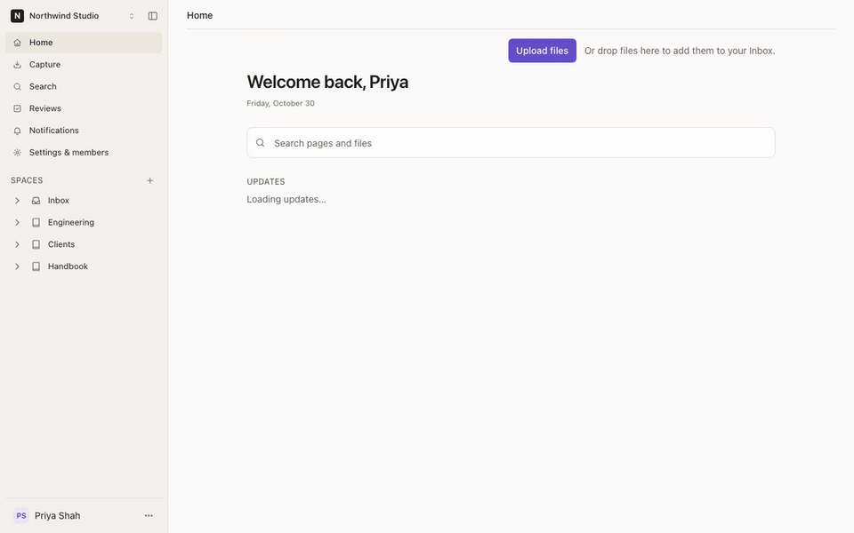
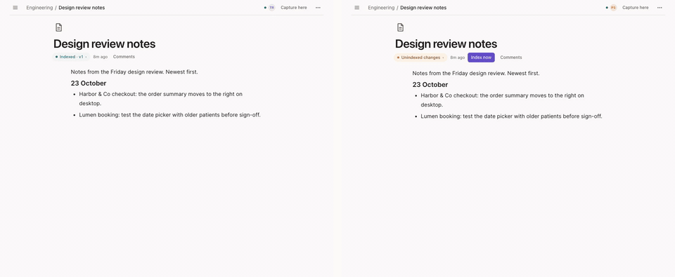
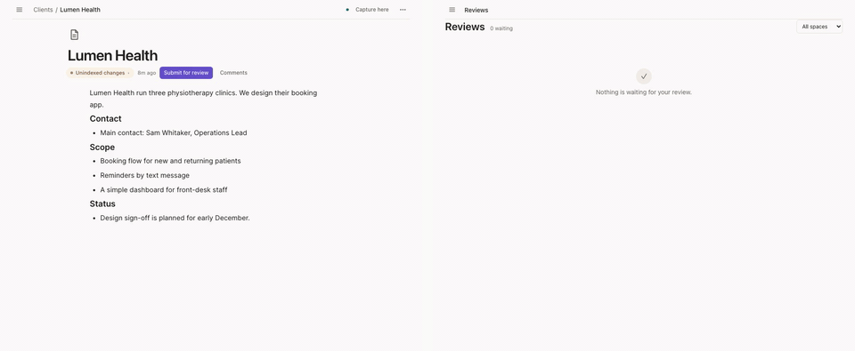
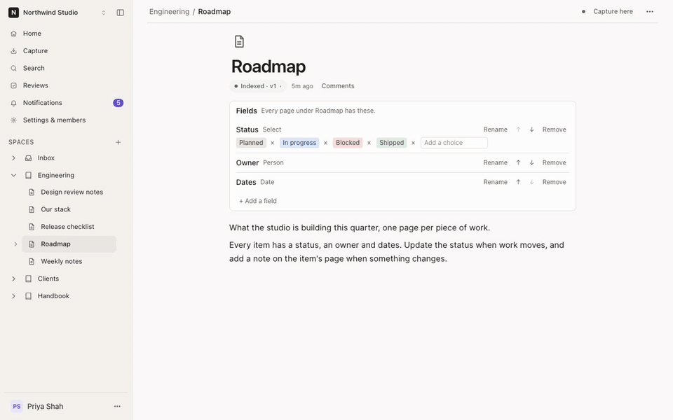
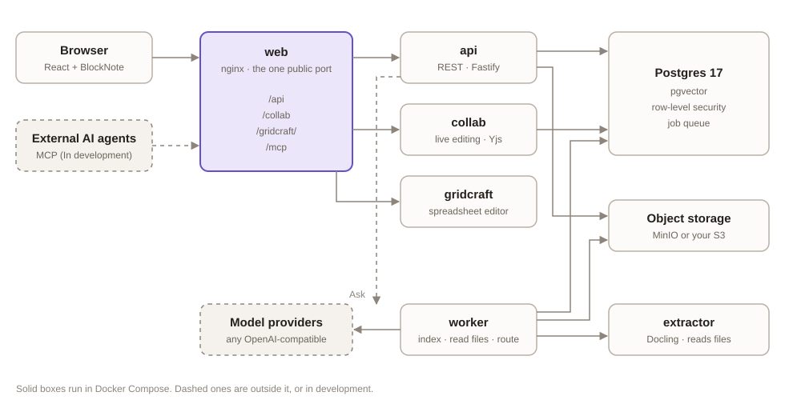

<p align="center">
  <picture>
    <source media="(prefers-color-scheme: dark)" srcset="site/public/logo-dark.svg">
    
  </picture>
</p>

<h3 align="center">Write it down once. Kinote files it everywhere it belongs.</h3>

<p align="center">
  A shared wiki for people and AI agents, that you can run yourself.
</p>

<p align="center">
  <a href="https://shinox-lab.github.io/Kinote/">Website</a> ·
  <a href="https://shinox-lab.github.io/Kinote/guide/">Docs</a> ·
  <a href="https://shinox-lab.github.io/Kinote/self-host/">Self-host</a> ·
  <a href="https://shinox-lab.github.io/Kinote/#hosted">Try Kinote</a>
</p>

<p align="center">
  <a href="LICENSE"></a>
  <a href="https://github.com/Shinox-lab/Kinote/stargazers"></a>
</p>

<p align="center">
  
</p>

## What is Kinote

Kinote is a wiki your team and your AI agents write together. Instead of hunting for the right page every time
something changes, you write it down once (a note, pasted meeting notes, a file) and Kinote edits the right pages
across your spaces, with a receipt, a reason for every change, and Undo. Everything stays searchable, and Ask answers
questions from your pages with citations.

## Features

- **Capture and routing.** Write something once; Kinote finds the pages it affects and edits them. Every change comes
  with a receipt, a reason, Undo, and "Wrong page → move to…".
- **Edit together, live.** People and AI agents on the same page at the same time, with cursors and live text.

<p align="center"></p>

- **Review where it matters.** Turn on review for a space and changes wait for a reviewer. Every page shows its state,
  from "awaiting approval" to "Indexed · v7", and any version can be restored. Anyone who can edit a space can archive
  a page in it and restore it later.

<p align="center"></p>

- **Files you can search.** PDFs, Office documents, spreadsheets and images, with previews, text extraction and a
  built-in spreadsheet editor.
- **Search and Ask.** Hybrid search across pages and files, and answers with citations that open the source.
- **Collections and views.** Give pages fields, then see them as a table, board, calendar or timeline.

<p align="center"></p>

- **Drawings, links and comments.** Sketch in the page, link with `[[`, see backlinks, and comment on any text.
- **Yours to run.** Multi-tenant workspaces kept apart by row-level security, Docker Compose, and any
  OpenAI-compatible models for search, Ask and routing.

Being built now:

- **WhatsApp groups as a source** (In development)
- **Google Drive sync** (In development)
- **MCP for external AI agents**: reading is ready (see below); capture and editing are in development
- **Self-maintaining wiki** (In development): follows changed sources, catches broken links and contradictions
- **Space export to Markdown** (In development)

## Quick start

You need Docker and about 4 GB of free memory.

```sh
git clone https://github.com/Shinox-lab/Kinote.git
cd Kinote && cp .env.example .env   # then fill in the six secrets
docker compose up -d
```

Open `http://localhost:8081` and sign up. The [self-hosting guide](https://shinox-lab.github.io/Kinote/self-host/)
covers the secrets, connecting models, reverse proxies, storage, upgrades and backups.

## Connect an agent

AI tools such as Claude Code can read your wiki over MCP (Model Context Protocol), file what they learn into it
through Capture, and fix exact words on a page with Edit. Each agent has its own tokens and sees only the spaces you grant it, and never more than the person
who owns it can see.

**Sign in from the client.** Any member can connect a client that supports MCP sign-in, with no token to copy. For
Claude Code:

```sh
claude mcp add --transport http kinote https://<your-kinote>/mcp
```

Then run `/mcp` in Claude Code and choose to authenticate. Your browser opens Kinote's sign-in page: pick the
workspace, name the agent and tick the spaces it may read. If the client asks to file captures or make edits too, you
can also tick **Also let it file what it learns** or **Also let it make precise edits**: the agent then gets Editor
access to those spaces (never more than you have), and its changes wait for review until an admin switches that off. Without it, the agent is read-only. Admins see it in
**Settings → Agents**, where revoking its token disconnects the client. The token lasts an hour and the client
renews it by itself for up to 90 days after it was last used.

**Or issue a token.** For headless agents, CI and clients without sign-in:

1. In **Settings → Agents**, add an agent and choose **where it can go**: Viewer (read) or Editor (read and change)
   for each space. Then issue a token and choose **what this token can do**: **Read**, plus **Capture** if it may file
   information and **Edit** if it may fix pages directly (both need Editor access to at least one space; without it,
   captures are refused and edits only become suggestions). An agent can hold several tokens, for example
   one with Capture for your laptop and a read-only one for CI. The token is shown once.
2. Connect the client. For Claude Code:

   ```sh
   claude mcp add --transport http kinote https://<your-kinote>/mcp --header "Authorization: Bearer <token>"
   ```

   Any MCP client that supports Streamable HTTP works the same way: the endpoint is `/mcp` and the token is a
   Bearer header.

A Read token gets six tools, a Capture token three more, and an Edit token five more:

| Tool | What it does |
| --- | --- |
| `kinote_browse` | The map: spaces and their page trees with a one-line summary per page. |
| `kinote_search` | Passages that match a query, with their page, section and block IDs, or the pages about it. |
| `kinote_read` | A page's outline, one section, or the whole page, with a cursor for long pages. |
| `kinote_related` | What connects to a page or a named thing: relationships, mentions, links in. |
| `kinote_ask` | An answer written from the wiki with its sources (costs an AI action). |
| `kinote_review` | Shows a Kinote review panel in clients with MCP Apps: what is waiting for your review (new versions, suggested edits, delete requests), each with Approve and Reject. The agent gets the list too. |
| `kinote_capture` | Files new information through routing, with a receipt; `preview: true` shows where it would go first. |
| `kinote_capture_action` | Status, answer a routing question, undo, move, or apply/cancel a preview. |
| `kinote_upload` | Shows a Kinote panel in clients with MCP Apps (claude.ai, Claude Desktop, VS Code Copilot…): your user drops the original file, and Kinote files it on its own under the page or space the agent named, or where its description fits. No page is made and the file needs no readable text. |
| `kinote_edit` | Replaces exact words in a block, adds blocks after one, sets a collection field, or renames the page, as the agent. Removals, blocks a person edited within the space's protection window, and spaces it can only read become suggestions on the page. |
| `kinote_create` | Creates a page exactly where the agent says: under a page, or at the top of a space. |
| `kinote_move` | Moves a page under another page or to the top of a space. A move into a space with review sends it back to review. |
| `kinote_delete` | Archives a page, saying why. Where the agent always reviews, or the space has review, it becomes a delete request a person accepts. |
| `kinote_restore` | Brings an archived page back; `kinote_browse` with `archived: true` lists them. |

Tokens expire after 90 days unless you choose otherwise (1 to 365), and an admin can revoke one or disable an agent at
any time. Each agent has its own rate limits and a daily limit of AI actions (100 unless you set another), and every
tool call is recorded in the audit log.

**Capture from an agent.** An agent files information the way a person does on the Capture page: routing decides
where each fact belongs, explains why, skips what is already known, and every change can be undone.

- New agents are set to **Always review its changes**: their changes wait for review even in spaces without review.
  Switch it off per agent in **Settings → Agents**.
- Routing questions go to the agent's owner on their Capture page, where they also see, undo and place the agent's
  captures. Turn on **Agents may answer routing questions** to let agents answer themselves.
- With `preview: true` nothing changes until the agent applies the plan, so it can show its user where each fact would
  go, skip or re-place facts, or cancel and edit by hand.
- A `source` (a URL or ticket ID) makes a retry safe: the same source and text return the first capture.
- **Stop and undo…** on an agent disables it and undoes what it filed since a time you choose.
- **Whole files.** A client can't hand a tool the original of a file you attached in the chat, only its text. When you
  want the file itself in Kinote, the agent calls `kinote_upload` with a sentence on what the file is, and a Kinote
  panel opens in the conversation: drop the file there (up to the upload limit, 50 MB by default) and press **Upload**.
  The panel uploads it as your own upload and Kinote files it: under the page, or at the top of the space, the agent
  named, or else where its description fits; when nothing fits clearly it stays in your Inbox and the receipt says
  why. No page is made, so a photo or a scan is filed like any other file; to put what a file says on a page, the
  agent writes it with `kinote_capture`. The panel needs a client that shows MCP Apps; in others, attach the file on
  the Capture page. Capture tokens also list four
  `kinote_upload_*` tools that only the panel uses.
- **Review in the conversation.** `kinote_review` opens a panel listing what waits for you: new versions, suggested
  edits and delete requests, each with its change. **Approve** and **Reject** act as you, by the same rules as the
  Reviews page (a reviewer where the space has review; never your own work unless the space allows it). The panel's
  buttons travel over the agent's connection and Kinote cannot tell your click from the agent's, so it relies on the
  client to keep those tools from the model. To decide an agent's changes only in Kinote, switch off **Approve in your
  AI client** for it in **Settings → Agents**. Read tokens list `kinote_review_list` and Edit tokens
  `kinote_review_decide`, which only the panel uses.

Notes typed into a capture, by a person or an agent, can say how to file it: "make a new page for this", "only update
the pages", "put it under Clients/George", "keep the file as a copy" or "don't keep the file". Text inside an attached
file never counts as an instruction. Without one, Capture decides by meaning whether an attached file is a record worth
keeping (a contract, a report, a deck) or only carried facts, which leaves it in the Inbox.

## How it works

<p align="center"></p>

The web app (React and BlockNote) talks to a Fastify API and a live-editing server (Hocuspocus and Yjs) through one
nginx entry point. A worker runs indexing, file reading and routing as idempotent jobs from a queue in PostgreSQL, which
also holds the pgvector search index and enforces row-level security per workspace. Files live in S3-compatible
storage, and a Docling service reads them. More in the
[contributing docs](https://shinox-lab.github.io/Kinote/contributing/).

## Contributing

Contributions are welcome. Start with [Repo layout and services](https://shinox-lab.github.io/Kinote/contributing/)
and [Development](https://shinox-lab.github.io/Kinote/contributing/development), then:

```sh
pnpm install
pnpm test
```

## License

[MIT](LICENSE) © Shinox-lab
