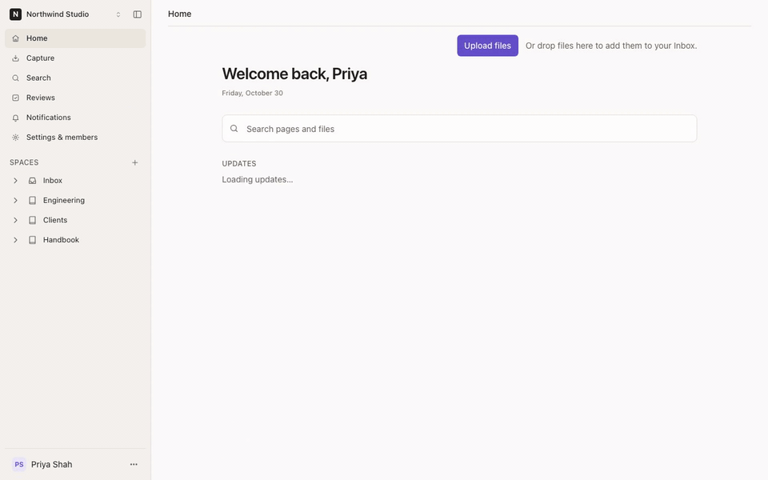
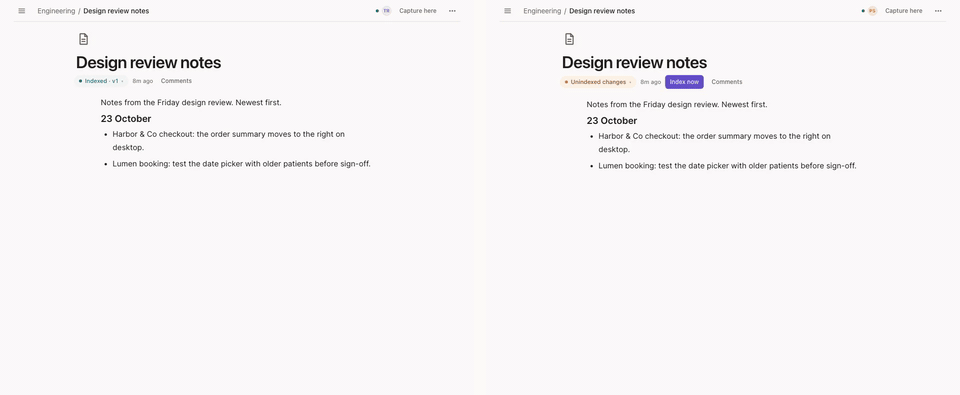
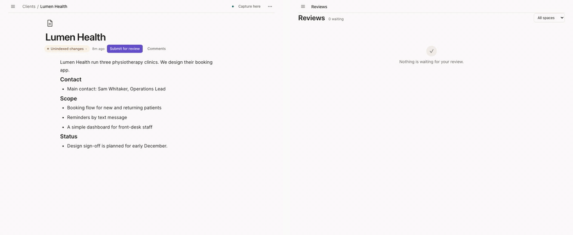
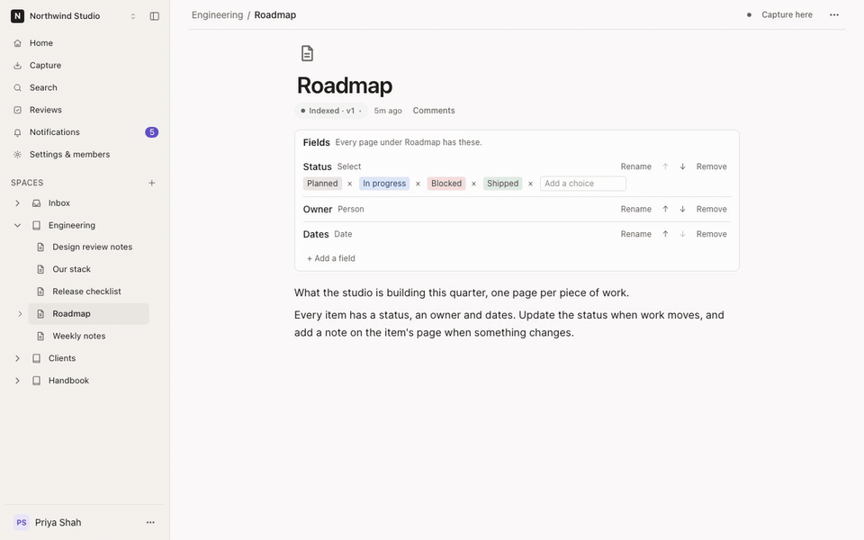
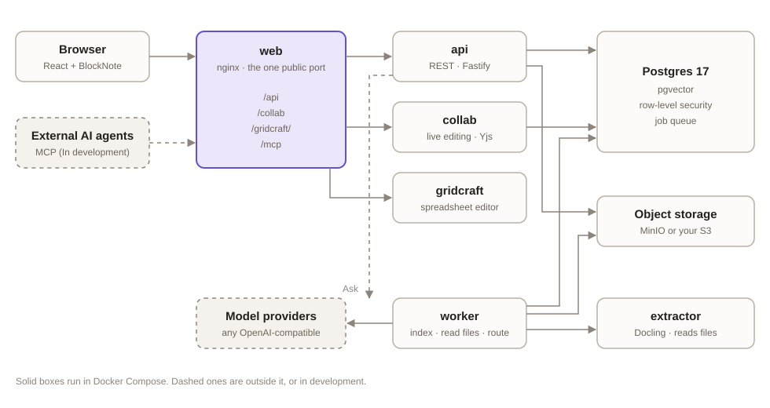

<p align="center">
  <picture>
    <source media="(prefers-color-scheme: dark)" srcset="site/public/logo-dark.svg">
    
  </picture>
</p>

<h3 align="center">Write it down once. Kinote files it everywhere it belongs.</h3>

<p align="center">
  A shared wiki for people and AI agents, that you can run yourself.
</p>

<p align="center">
  <a href="https://shinox-lab.github.io/Kinote/">Website</a> ·
  <a href="https://shinox-lab.github.io/Kinote/guide/">Docs</a> ·
  <a href="https://shinox-lab.github.io/Kinote/self-host/">Self-host</a> ·
  <a href="https://shinox-lab.github.io/Kinote/#hosted">Try Kinote</a>
</p>

<p align="center">
  <a href="LICENSE"></a>
  <a href="https://github.com/Shinox-lab/Kinote/stargazers"></a>
</p>

<p align="center">
  
</p>

## What is Kinote

Kinote is a wiki your team and your AI agents write together. Instead of hunting for the right page every time
something changes, you write it down once (a note, pasted meeting notes, a file) and Kinote edits the right pages
across your spaces, with a receipt, a reason for every change, and Undo. Everything stays searchable, and Ask answers
questions from your pages with citations.

## Features

- **Capture and routing.** Write something once; Kinote finds the pages it affects and edits them. Every change comes
  with a receipt, a reason, Undo, and "Wrong page → move to…".
- **Edit together, live.** People and AI agents on the same page at the same time, with cursors and live text.

<p align="center"></p>

- **Review where it matters.** Turn on review for a space and changes wait for a reviewer. Every page shows its state,
  from "awaiting approval" to "Indexed · v7", and any version can be restored.

<p align="center"></p>

- **Files you can search.** PDFs, Office documents, spreadsheets and images, with previews, text extraction and a
  built-in spreadsheet editor.
- **Search and Ask.** Hybrid search across pages and files, and answers with citations that open the source.
- **Collections and views.** Give pages fields, then see them as a table, board, calendar or timeline.

<p align="center"></p>

- **Drawings, links and comments.** Sketch in the page, link with `[[`, see backlinks, and comment on any text.
- **Yours to run.** Multi-tenant workspaces kept apart by row-level security, Docker Compose, and any
  OpenAI-compatible models for search, Ask and routing.

Being built now:

- **WhatsApp groups as a source** (In development)
- **Google Drive sync** (In development)
- **MCP for external AI agents** (In development)
- **Self-maintaining wiki** (In development): follows changed sources, catches broken links and contradictions
- **Space export to Markdown** (In development)

## Quick start

You need Docker and about 4 GB of free memory.

```sh
git clone https://github.com/Shinox-lab/Kinote.git
cd Kinote && cp .env.example .env   # then fill in the six secrets
docker compose up -d
```

Open `http://localhost:8081` and sign up. The [self-hosting guide](https://shinox-lab.github.io/Kinote/self-host/)
covers the secrets, connecting models, reverse proxies, storage, upgrades and backups.

## How it works

<p align="center"></p>

The web app (React and BlockNote) talks to a Fastify API and a live-editing server (Hocuspocus and Yjs) through one
nginx entry point. A worker runs indexing, file reading and routing as idempotent jobs from a queue in PostgreSQL, which
also holds the pgvector search index and enforces row-level security per workspace. Files live in S3-compatible
storage, and a Docling service reads them. More in the
[contributing docs](https://shinox-lab.github.io/Kinote/contributing/).

## Contributing

Contributions are welcome. Start with [Repo layout and services](https://shinox-lab.github.io/Kinote/contributing/)
and [Development](https://shinox-lab.github.io/Kinote/contributing/development), then:

```sh
pnpm install
pnpm test
```

## License

[MIT](LICENSE) © Shinox-lab
